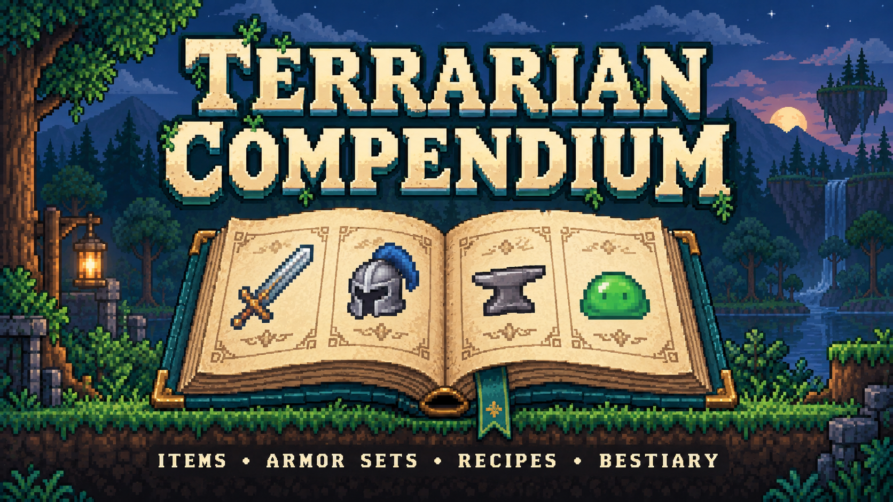

# Terrarian Compendium



**Find what you need, see how to obtain it, and track your collection.**

[Download on Nexus Mods](https://www.nexusmods.com/terraria/mods/245)

Terrarian Compendium adds an in-game reference and collection browser for vanilla Terraria. Browse items, armor sets, recipes, Shimmer transformations, NPCs and Angler quests in one window, with linked information that helps you follow an ingredient to its source, a Shimmer result to its transformation, a drop to its enemy, an armor piece to its set, or a quest reward to its item details.

Use it to plan your next craft, look up an item, or work towards a complete collection. Your collection records what each character has found, even after those items leave your inventory.

## Features

- Browse **Items**, **Armor Sets**, **Recipes**, **Shimmer**, **Bestiary** and **Angler** in a movable, resizable window with Back and Forward navigation. Pin the window to keep it open when pressing Escape.
- Open items from supported Terraria slots in **Items** with **Alt+Right Click**, or see recipes that use them in **Recipes** with **Ctrl+Alt+Right Click**. Both shortcuts use the browser's Back and Forward history.
- Search item and NPC names, narrow results with category and progress filters, and choose from several sorting options. Item search can also include descriptions.
- Track your item collection for each character, spot missing items through silhouettes, and view Journey Mode research status. Fully researched items in the Compendium can be duplicated with Journey Mode shortcuts.
- Explore item sources: crafting, NPC drops, potential merchant stock, chests, pots, tree shaking, fishing, and possible contents of bags, crates and other openable items.
- Check recipe ingredients, alternatives, crafting stations and other requirements. Open an item in **Recipes** to browse recipes that use it, save favorite recipes, filter by **Craftable Now**, and craft directly from item or recipe details.
- Browse **Shimmer** results, follow links between items and their transformations, and inspect direct transformations or decrafting with their progression, world and moon-phase conditions. Filter Shimmer results by **Collection**, **Research**, **Transformation** and **Progression**.
- Look up armor set bonuses and valid combinations of armor pieces, including sets with multiple variants.
- Check the current **Angler** quest, whether it has been completed today, total completed quests, all milestone rewards, and the reward groups. Reward items link back into normal Item browsing.
- Browse NPC encounter progress, habitats, debuff immunities and item drops with their chances and conditions. NPC Details can also show kill statistics and banner progress when available. Filter NPCs by Bestiary criteria, including whether they have ordinary drops or a banner item, whether any of those items are missing from your collection, and—when Journey research is available—whether any are still unresearched. Compare Classic, Expert and Master stats for your current world's progression.

## Collection Tracking

Items are discovered from your inventory, equipment and other loadouts. With **Storage Discovery** enabled, items in supported vanilla storage are also discovered while you have that storage open.

Once an item is marked as found, it stays in that character's collection. Selling, consuming or crafting with it does not remove the discovery. In Journey Mode, you can also view and filter by research status.

## Crafting and Item Sources

Open an item or recipe, select **Craft**, then choose an available recipe. Hold its button to keep crafting. This uses your materials and follows Terraria's normal crafting requirements, including nearby stations and environmental conditions. Materials can come from your inventory and an open vanilla chest when Terraria allows it.

Merchant stock lists show what an NPC can sell and the conditions attached to those items. Check those conditions when planning a purchase: an entry in the Compendium does not mean the merchant is selling it right now.

Opening an item in **Recipes** shows recipes that use it. Items with no related recipes can still be opened; the Compendium explains the empty result. Your search, selected category and recipe filters remain active as you browse. Turning off **Favorites-only** keeps your saved favorites and other filters.

## Shimmer

Browse possible Shimmer results and the transformations that can produce them, including direct transformations and decrafting. View conditions such as game progression, world evil and moon phase, even for transformations not currently available, and follow related items or recipes for details. The Compendium is a reference: transformations themselves must be performed in Terraria.

## Settings

Press **F6** to open TerrariaModder's mod menu, then select **Terrarian Compendium**.

- **Storage Discovery** — Mark items as found while supported vanilla storage is open. Enabled by default.
- **Inventory Item Navigation** — Enable shortcuts from Terraria item slots: **Alt+Right Click** for **Items** and **Ctrl+Alt+Right Click** for **Recipes**. Enabled by default; disabling it turns off both shortcuts.

## Controls

- **Alt+I** — Open or close Terrarian Compendium while in a world.
- **Pin / Unpin** in the window header — Prevent Escape from closing the window itself while pinned. The close button and **Alt+I** still close it, and pinning resets after reopening.
- **Escape** — First release search text focus, then close an open popup, then close the unpinned window; each press performs one available action. While pinned, other unpinned mod windows may still respond to Escape when no search field or popup is active in the Compendium.
- **Alt+Right Click** on a supported Terraria item slot — Open the hovered valid item in **Items**. Supported locations are the main inventory, coin/ammo slots, an open chest or personal storage, equipment/vanity/dye/misc-equipment slots, and the current NPC shop.
- **Ctrl+Alt+Right Click** on the same supported slots — Open **Recipes** to see what can be crafted using the hovered item.
- **Alt+Left Click** on a fully researched item inside the Compendium — Duplicate a full stack in Journey Mode.
- **Alt+Right Click** on a fully researched item inside the Compendium — Duplicate one item; hold the button to keep duplicating items one at a time.
- **Alt+Left Click** on the category up arrow in **Items**, **Recipes** or **Shimmer** — Return directly to that section's root.

You can rebind **Toggle Terrarian Compendium** in TerrariaModder's **F6** menu. Both vanilla-slot navigation shortcuts are fixed and controlled together by **Inventory Item Navigation**. That setting does not disable Journey duplication actions inside the Compendium.

## Requirements

- **Terraria 1.4.5.8** for Windows.
- [TerrariaModder Core](https://www.nexusmods.com/terraria/mods/135) **0.4.2** (1.4.0 development target).
- **.NET Framework 4.8**.

## Installation

1. Install the required version of TerrariaModder Core using the instructions on its download page. Close Terraria before copying mod files.
2. Download the main file from the [Files tab on Nexus Mods](https://www.nexusmods.com/terraria/mods/245?tab=files) and extract the archive.
3. Inside your Terraria installation folder, which contains `Terraria.exe`, create `TerrariaModder\mods\terrarian-compendium\` if needed. Place `TerrarianCompendium.dll` and `manifest.json` directly inside that mod folder.
4. Launch the game through `TerrariaInjector.exe` in your Terraria installation folder.
5. Enter a world and press **Alt+I** to open the Compendium.

## Compatibility

### Existing characters and worlds

You can use the mod with an existing character and world. Collection tracking picks up items you currently carry, equip or access through opened storage; it cannot reconstruct a complete history of everything collected before installation.

### Removing the mod

Close Terraria and remove the `terrarian-compendium` mod folder to disable its interface and tracking. The mod adds no custom items, NPCs or world generation to your characters or worlds. Its separately stored collection records and recipe favorites remain on disk.

### Multiplayer

The interface and collection tracking belong to the local player. Collection records and recipe favorites are not shared between players. Host & Play was validated for version 1.4.0, including crafting from inventory and an open vanilla chest. Other multiplayer setups have not been fully verified.

### Saved progress

Local and Steam Cloud versions of a character keep separate collection records. Recipe favorites are shared by characters using the same Terraria save folder and are not synchronized between installations.

### Other mods

Built for vanilla Terraria through TerrariaModder.

## Languages

- English.
- Russian.

The mod interface follows Terraria's language setting, with English as the fallback for other languages. Vanilla item names, descriptions and NPC names use the game's current language.

## Development

The source project targets .NET Framework 4.8 and includes a separate NUnit test project. It imports the MIT-licensed [TerrariaWindowKit](https://github.com/EscarvalOokt/TerrariaWindowKit) directly from a sibling source checkout; no separate toolkit DLL is referenced or deployed. The expected layout is:

```text
<workspace>/
  TerrarianCompendium/
  TerrariaWindowKit/
```

For this 1.4.0 development source, use the [TerrariaWindowKit v1.1.0 tag](https://github.com/EscarvalOokt/TerrariaWindowKit/releases/tag/v1.1.0) in the sibling checkout. The project imports the sources currently present in that directory; it does not pin the checkout to a tag or commit. Build with a compiler supporting C# 12 or later (for example, .NET SDK 8).

Copy the [local properties example](docs/TerrarianCompendium.Local.props.example) to `src/TerrarianCompendium.Local.props` and configure the Terraria installation, XNA and ReLogic references described in that example. From the Compendium repository root, build and run tests with:

```powershell
dotnet build src/TerrarianCompendium/TerrarianCompendium.csproj -c Release -p:DeployToGame=false
dotnet test tests/TerrarianCompendium.Tests/TerrarianCompendium.Tests.csproj -c Release -p:DeployToGame=false
```

These commands validate the local source/dependency combination, not a release package or in-game compatibility. See [Architecture](docs/architecture.md) for ownership boundaries and [Testing policy](docs/testing.md) for runtime and package acceptance requirements.

## Links

- [Nexus Mods page](https://www.nexusmods.com/terraria/mods/245).
- [GitHub Releases](https://github.com/EscarvalOokt/TerrarianCompendium/releases).

Feedback and bug reports are welcome.